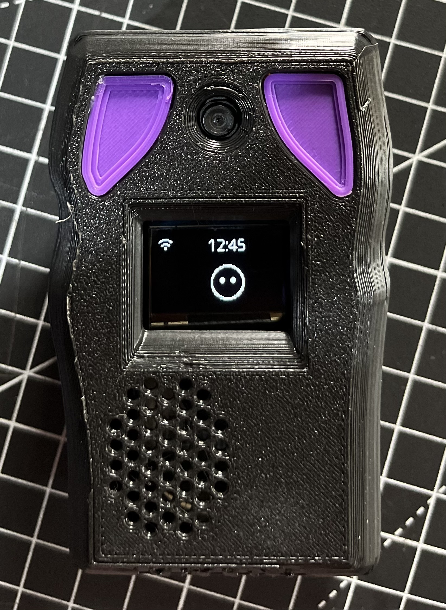
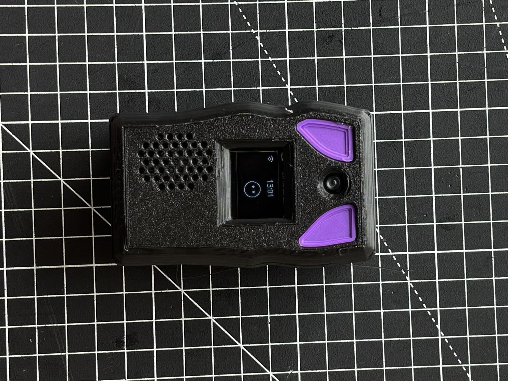
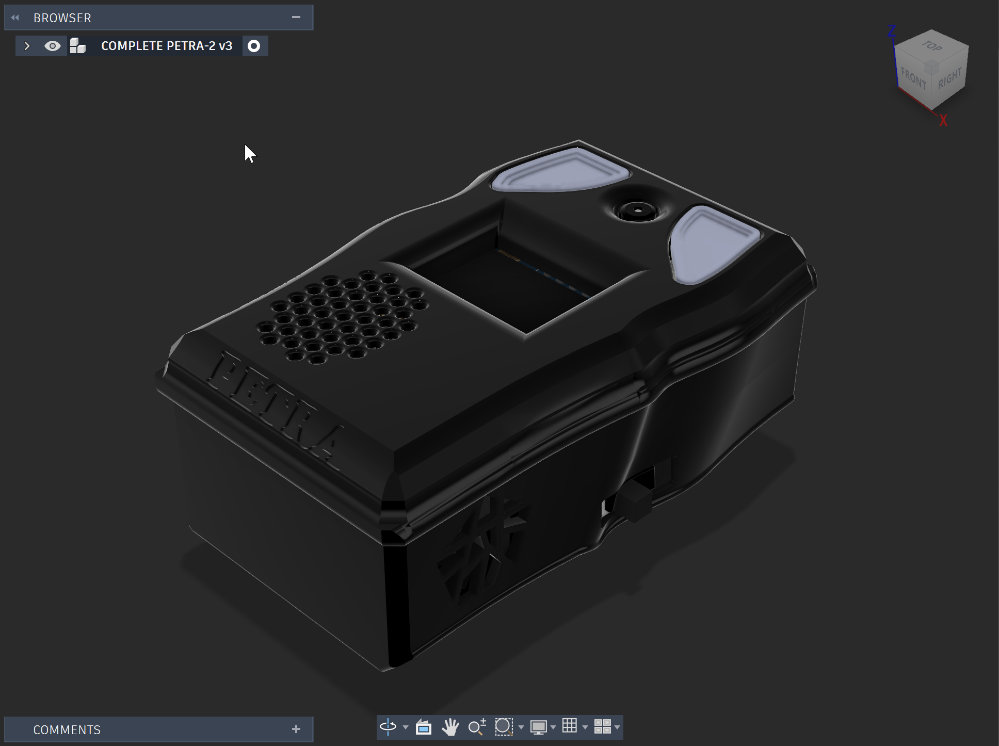

# Petra

Petra is a small voice assistant built by PlastiBytes for exhibitions. You talk to her, she answers, takes photos and controls other devices on the stand (an ePaper display and a smart lamp).

<p align="center">
  
  
</p>

<p align="center">
  <br>
  <em>3D model of the enclosure (COMPLETE PETRA-2 v3)</em>
</p>

## What it does

- **Talks**: say *"Hey Petra"*, ask a question, she answers out loud (AI from xiaozhi.me).
- **Sees**: the built-in camera takes photos ("take my picture") and looks at objects ("can this be recycled?").
- **Shows**: photos, QR codes, recycling answers and step-by-step guides appear on the ePaper panel.
- **Controls**: turns the stand lamp on/off by voice; the lamp also works alone with its presence sensor.

Each device works on its own. They talk to each other through the xiaozhi.me **MCP endpoint** and the local Wi-Fi.

## Hardware

| Device | Board | Parts |
|---|---|---|
| Petra | Seeed XIAO ESP32S3 Sense | OV3660/OV2640 camera, PDM mic, MAX98357A amp + speaker, OLED, LiPo battery, 3D-printed case |
| ePaper panel | Seeed XIAO 7.5" ePaper (ESP32-C3) | - |
| Smart bulb | XIAO ESP32-C3 | presence sensor, relay, mains lamp |

## Project layout

```
firmware/petra/          Xiaozhi firmware (ESP-IDF) + our board in main/boards/petra-xiao-s3/
firmware/epaper-panel/   ePaper panel (PlatformIO)
firmware/bulb/           Smart bulb (PlatformIO)
firmware/shared-libs/    WifiStore + xiaozhi-mcp, used by panel and bulb
tools/pcb-test/          PCB test sketch (OLED + speaker)
tools/virtual-display/   PC version of the ePaper panel (Python)
shared/protocol.md       Local HTTP API between devices
docs/                    Guides, prompt, knowledge base, images
```

## Quick start

**Petra** (ESP-IDF v6.1, in an ESP-IDF terminal):

```powershell
cd firmware\petra
python scripts\build.py petra-xiao-s3 --language en-US
idf.py -p COM15 flash monitor
```

**ePaper panel / bulb** (PlatformIO):

```powershell
cd firmware\epaper-panel      # or firmware\bulb
pio run -t upload
```

**First setup**: each device opens its own Wi-Fi hotspot. Join it from your phone, pick your Wi-Fi and paste the MCP endpoint from xiaozhi.me → Console → Agents → Petra. Then paste `docs/petra-prompt.md` into the agent's prompt.

## Secrets

Wi-Fi passwords and the MCP token are **never** committed. Copy the example files and fill them in:

- `firmware/*/include/secrets.example.h` → `secrets.h`
- `tools/virtual-display/config.example.json` → `config.json`

## More documentation

- [docs/build-guide.md](docs/build-guide.md): full install, build, flash and usage guide
- [docs/troubleshooting.md](docs/troubleshooting.md): known problems and fixes
- [PLAN.md](PLAN.md) / [IMPLEMENTATION_PLAN.md](IMPLEMENTATION_PLAN.md): goals and design
- [shared/protocol.md](shared/protocol.md): device-to-device API
